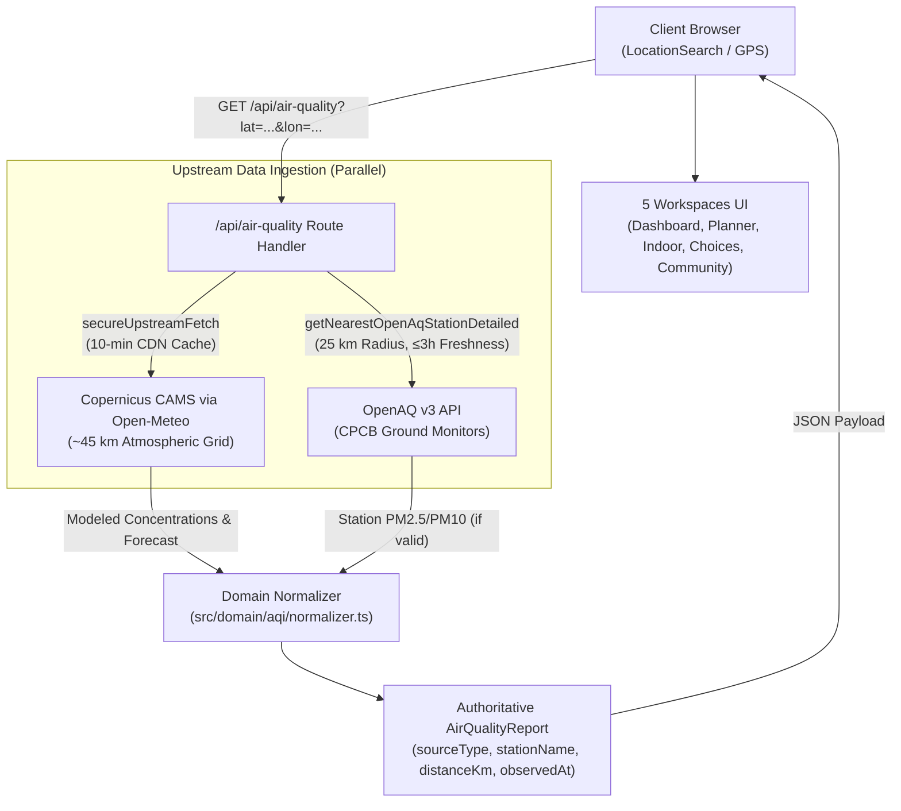
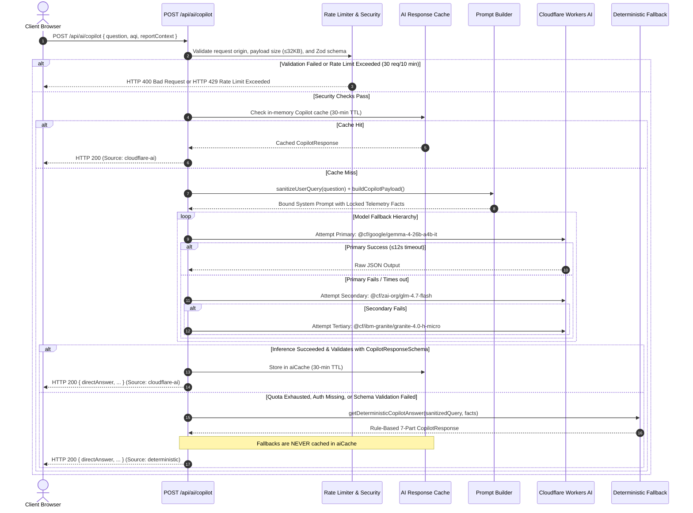

# AirAware — System Architecture & Technical Specification

AirAware is an environmental intelligence web platform built with Next.js 16 and TypeScript. It is designed to assist families and communities in navigating severe winter smog through low-emission routines, indoor air quality hacks, and sustainable alternatives.

---

## 1. System Context & Data Flow

### 1.1 Environmental Telemetry Data Flow

The diagram below illustrates how client coordinates resolve into an authoritative `AirQualityReport`:



### 1.2 Air Copilot Request Lifecycle & Fallback Chain

The diagram below traces an interactive inquiry through input sanitization, rate limiting, caching, inference, and failover:



---

## 2. Repository Directory Structure (Depth 3)

```
AirAware/
├── public/                          # Static assets and WebGL textures
│   ├── images/landing/              # Educational WebP landing illustrations
│   └── textures/                    # Earth sphere textures & GeoJSON boundaries
├── src/
│   ├── app/                         # Next.js App Router root
│   │   ├── api/                     # Server-only API route handlers
│   │   │   ├── ai/                  # AI Copilot & Guidance endpoints
│   │   │   ├── air-quality/         # Primary environmental telemetry resolver
│   │   │   ├── locations/           # Geocoding search endpoint
│   │   │   ├── regional-hotspots/   # Multi-city regional compare endpoint
│   │   │   └── weather/             # Meteorological surface telemetry endpoint
│   │   ├── globals.css              # Global styles & accessibility reset
│   │   ├── layout.tsx               # Root HTML document & skip link
│   │   └── page.tsx                 # Root application entry point
│   ├── components/                  # User interface presentation layer
│   │   ├── charts/                  # SVG charts (role="img" with table toggles)
│   │   ├── choices/                 # Cleaner Choices & transit impact workspace
│   │   ├── common/                  # Reusable Error Boundaries & wrappers
│   │   ├── community/               # Civic alerts, RWA bulletins & incident logger
│   │   ├── copilot/                 # Copilot rich structured response renderer
│   │   ├── dashboard/               # Air Intelligence Studio & hero views
│   │   │   └── hero/                # Overview, Regional Compare, and Globe panels
│   │   ├── globe/                   # MapLibre & Three.js 3D Earth visualizations
│   │   ├── indoor/                  # Indoor Air Sanctuary & CADR calculator
│   │   ├── planner/                 # Family Daily Planner & profile manager
│   │   ├── shell/                   # Application shell, navigation & drawers
│   │   └── welcome/                 # Onboarding walkthrough modal
│   ├── domain/                      # Pure business logic and mathematical models
│   │   ├── ai/                      # Copilot natural-language intent parser
│   │   ├── aqi/                     # AQI normalizer, CPCB engine, OpenAQ adapter
│   │   ├── choices/                 # DEFRA transport emissions calculator
│   │   ├── community/               # Alert generator & incident storage
│   │   ├── constants/               # Authoritative storage keys & telemetry limits
│   │   ├── household/               # Household schemas, types & storage adapters
│   │   ├── indoor/                  # Room volume, CADR formulas & ventilation logic
│   │   ├── planner/                 # Actionable recommendation engine & impact logic
│   │   └── types.ts                 # Authoritative shared domain models
│   ├── lib/                         # Infrastructure, network & security utilities
│   │   ├── ai/                      # Cloudflare client, cache, prompt builder, rate limiter
│   │   ├── openaq/                  # OpenAQ API configuration helper
│   │   └── security/                # Upstream URL validation & SSRF protection
│   └── tokens/                      # Authoritative design tokens
│       └── tokens.css               # WCAG 2.2 AA compliant palette & severity tokens
└── tests/
    └── unit/                        # Automated unit & integration tests
        ├── a11y/                    # WCAG 2.2 AA accessibility verification
        ├── aqi/                     # AQI formulas, normalization & CPCB benchmarks
        ├── indoor/                  # CADR sizing & filter log assertions
        ├── planner/                 # Recommendation engine & profile tests
        └── security/                # Route validation, SSRF & injection tests
```

---

## 3. Server-Side API Routes

| Endpoint | Method | Input Validation | Upstream Services | Caching & Rate Limits |
|----------|--------|------------------|-------------------|----------------------|
| `/api/air-quality` | `GET` | `AirQualityQuerySchema`<br>(lat: -90..90, lon: -180..180, timezone regex) | Open-Meteo CAMS Air Quality API<br>OpenAQ v3 API | CDN Cache: `s-maxage=600, stale-while-revalidate=300`<br>Rejects extraneous query parameters. |
| `/api/weather` | `GET` | `WeatherQuerySchema`<br>(lat: -90..90, lon: -180..180, timezone regex) | Open-Meteo Weather Forecast API | CDN Cache: `s-maxage=900, stale-while-revalidate=300`. |
| `/api/locations/search` | `GET` | `SearchQuerySchema`<br>(name: 2..100 chars, count: 1..10) | Open-Meteo Geocoding API | CDN Cache: `s-maxage=3600, stale-while-revalidate=1800`<br>Upstream revalidation: 86,400s (24 hours). |
| `/api/regional-hotspots` | `GET` | No query parameters permitted (rejects unknown params) | Open-Meteo Air Quality API (batched) | In-memory cache: 15 minutes (`CACHE_TTL_MS = 900000`).<br>Rate limit: 20 req/5 min per client hash. |
| `/api/ai/guidance` | `POST` | `GuidanceRequestSchema`<br>Payload limit: 32 KB (`MAX_AI_PAYLOAD_BYTES`) | Cloudflare Workers AI | Rate limit: 30 req/10 min sliding window.<br>In-memory AI cache: 30 minutes (`AI_CACHE_DEFAULT_TTL_MS`). |
| `/api/ai/copilot` | `POST` | `CopilotRequestSchema`<br>Payload limit: 32 KB (`MAX_AI_PAYLOAD_BYTES`) | Cloudflare Workers AI | Rate limit: 30 req/10 min sliding window.<br>In-memory AI cache: 30 minutes (`AI_CACHE_DEFAULT_TTL_MS`). |

---

## 4. Authoritative Domain Concepts

### 4.1 AirQualityReport Shape
Defined in `src/domain/types.ts`:
- `sourceType`: `'station' | 'model'` indicating whether telemetry originated from a physical ground monitor or atmospheric numerical model.
- `stationName`: string or `null` (e.g. `"Anand Vihar, Delhi - DPCC"`).
- `distanceKm`: number or `null` (distance in kilometers from query point to ground station).
- `observedAt`: ISO string or `null` (observation timestamp from the physical sensor).
- `modelFallbackReason`: string or `null` (`"no recent station within 25 km"`, `"station data too old"`, or `"service busy"`).
- `pollutants`: Sub-indices, raw concentrations, units, and WHO 2021 ratios across 6 pollutants (`pm2_5`, `pm10`, `carbon_monoxide`, `nitrogen_dioxide`, `sulphur_dioxide`, `ozone`).

### 4.2 Primary AQI Single Source of Truth
The function `getPrimaryAqiFacts()` in `src/domain/aqi/primary-aqi.ts` serves as the authoritative single source of truth across the Dashboard, Copilot, and Planner:
1. Defaults to Indian CPCB NAQI for Indian coordinates or when CPCB comparison is available.
2. Formats resolved data source string with ground station distance or CAMS model grid details.
3. Attaches explicit model fallback reasons directly from the report without re-derivation.

### 4.3 Indian CPCB NAQI Engine
Implemented in `src/domain/aqi/cpcb-benchmark.ts`:
- Employs piecewise linear interpolation across official CPCB breakpoints: Good (0–50), Satisfactory (51–100), Moderate (101–200), Poor (201–300), Very Poor (301–400), and Severe (401–500).
- Calculates composite CPCB index using the standard maximum sub-index rule: $\max(I_{\text{PM2.5}}, I_{\text{PM10}})$.
- **Honest Limitation**: AirAware explicitly labels its Indian index as a **PM2.5/PM10 particulate sub-index**, not the full regulatory 8-pollutant NAQI, because official NAQI mandates 24-hour averages across at least three criteria pollutants including either PM2.5 or PM10.

### 4.4 Daytime Ventilation & Cleanest Window Algorithm
Implemented in `src/domain/aqi/best-window.ts` (`findBestDaytimeWindow`):
- Filters forecast points between 07:00 and 19:00 to examine daytime diurnal conditions.
- Evaluates consecutive sliding windows of 2 to 3 hours to identify the minimum particulate exposure period.
- Recommends window shifts from morning inversion hours (07:00–10:00 AM) to solar peak breakup hours (12:30–03:30 PM).

### 4.5 Household Profile & Vulnerability Engine
Defined in `src/domain/household/`:
- **Archetypes**: `CHILD_STUDENT`, `WORKING_COMMUTER`, `SENIOR_VULNERABLE`, `OUTDOOR_ENTHUSIAST`.
- **Sensitivity Tiers**: `PEDIATRIC`, `SENIOR`, `RESPIRATORY`, `CARDIOVASCULAR`, `NONE`.
- **Invariants**: Maximum 4 household members per browser profile; schedule duration bounded between 5 and 720 minutes.

### 4.6 Indoor Air & CADR Purifier Physics
Implemented in `src/domain/indoor/calculations.ts`:
- Room Volume: $V = \text{Length} \times \text{Width} \times \text{Height}$ ($m^3$).
- Required CADR: $\text{CADR} = V \times \text{Target ACH}$ (default target is 4.8 Air Changes per Hour for particle containment).
- Derated Sleep Mode: Accounts for a 60% reduction in clean air turnover when purifiers operate in quiet/night fan modes.
- **Estimated vs Measured Indoor Reading**: If the user lacks an indoor sensor, indoor PM2.5 is labeled as an **estimate** based on standard residential building shell infiltration (~60% of ambient outdoor PM2.5). When the user enters a reading, it switches to verified measurement analysis.
- **Houseplants Reality Check**: Scientific consensus confirms houseplants provide aesthetic comfort and modest humidity, but cannot substitute for mechanical HEPA air filtration.

---

## 5. Grounded Prompt Engineering & LLM Safety

Prompts reside in `src/lib/ai/prompt-builder.ts`:
1. **Fact Locking**: Live telemetry (AQI, category, pollutant concentrations, weather, data source, and station distance) is injected as immutable context in the system prompt.
2. **Strict Rule Invariants**:
   - Model is instructed: *"Lock all numbers to the authoritative facts above. Do NOT alter AQI values or pollutant numbers... Never state precise numbers unless provided in facts."*
   - Scale enforcement: When scale is CPCB NAQI, the model is forbidden from using US EPA labels like "Unhealthy" or "Hazardous".
3. **Injection Sanitization**: `sanitizeUserQuery()` strips control characters (`[\x00-\x1F\x7F-\x9F]`), removes angle brackets (`<` and `>`), and truncates inputs to 200 characters.
4. **Structured JSON Validation**: Models return structured JSON validated via Zod schemas (`GuidanceResponseSchema`, `CopilotResponseSchema`). Responses that fail schema validation never show raw text to users; they fall closed immediately to `src/lib/ai/deterministic-fallback.ts`.

---

## 6. Client-Side State & Storage Architecture

### 6.1 Authoritative `localStorage` Keys
Managed centrally in `src/domain/constants/storage-keys.ts`:
- `airaware_household_v1`: Household profiles, archetypes, and daily schedule items.
- `airaware_saved_locations`: User's pinned and favorite locations.
- `airaware_last_location`: Most recently viewed active location.
- `airaware_copilot_sessions_v1`: Local conversation history (maximum 20 sessions, 50 messages per session).
- `airaware_indoor_v1`: Room dimensions, custom CADR targets, filter vacuuming dates, and indoor sensor readings.
- `airaware_onboarding_completed_v1`: Onboarding completion flag.
- `airaware_cleaner_choices_v1`: Commute comparison distances, active transit modes, and adopted habit IDs.
- `airaware_community_v1`: Local incident journal and notification state.
- `airaware_personalization_banner_dismissed`: UI banner display preference.
- `airaware_active_plan`: Active daily plan routine states.

### 6.2 Data Privacy Guarantees
- **What is Never Stored**: User passwords, access tokens, telemetry logs, or raw GPS coordinates on any server.
- **Data Erasure**: Calling `clearAllAirAwareData()` deletes every registered `airaware_*` key, dynamic `plan_*` keys, and completely clears `sessionStorage`.

---

## 7. Performance & Optimization Architecture

- **Bundle Separation**: Three.js and MapLibre GL are isolated via `dynamic(() => import(...), { ssr: false })` in `src/components/dashboard/AqiHeroCard.tsx`.
- **Deduplication**: `aiCache` maintains an in-flight Promise map (`inFlightGuidance`, `inFlightCopilot`). Concurrent identical requests join the active single-flight Promise rather than issuing duplicate calls to Cloudflare Workers AI.
- **Caching Cadences**:
  - Open-Meteo CAMS telemetry: 10-minute Next.js CDN cache (`OPEN_METEO_REVALIDATE_SECONDS = 600`).
  - Regional hotspots: 15-minute in-memory cache (`CACHE_TTL_MS = 15 * 60 * 1000`).
  - Geocoding searches: 24-hour cache (`revalidate: 86400`).
  - Cloudflare AI responses: 30-minute in-memory cache (`AI_CACHE_DEFAULT_TTL_MS = 30 * 60 * 1000`). Fallback responses are never cached.

---

## 8. Architectural Trade-Offs & Rationale

1. **Why Local-First (No Server-Side Database / Auth)?**
   - Eliminates PII risk for sensitive family vulnerabilities (children, health conditions).
   - Zero signup barrier allows immediate access during acute smog emergencies.
   - Eliminates database hosting costs, enabling a sustainable ₹0 operating budget.

2. **Why Ground Stations + Numerical Model?**
   - Official CPCB monitors provide ground truth within 25 km, but monitor density varies across India.
   - Copernicus CAMS (~45 km grid) ensures complete spatial coverage and hourly forecasts for any coordinates nationwide.
   - Transparent provenance labels prevent misleading users about data origins.

3. **Why Custom Components Instead of Generic Agentic UI?**
   - Guarantees strict adherence to WCAG 2.2 AA contrast ratios and accessibility landmarks.
   - Full control over visual styling, responsive design tokens, and lightweight SVG charting without heavy runtime dependencies.
